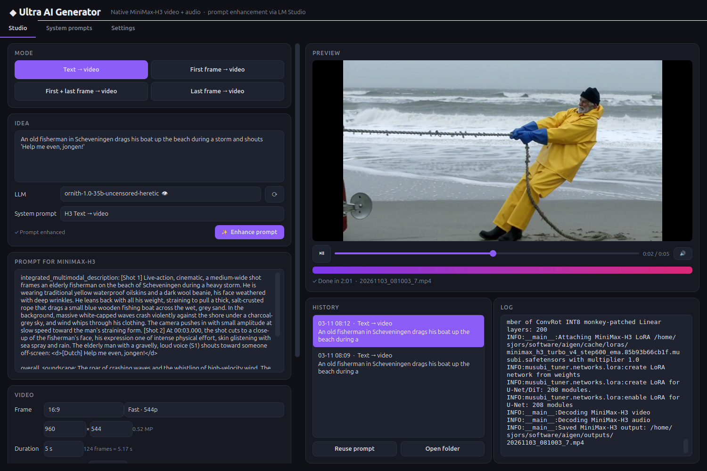
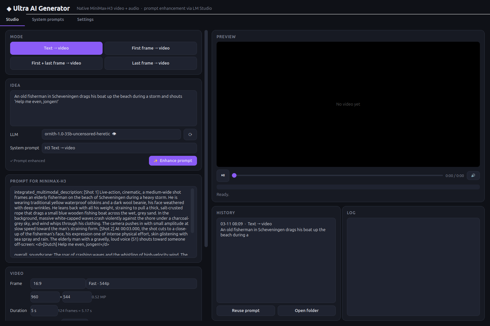
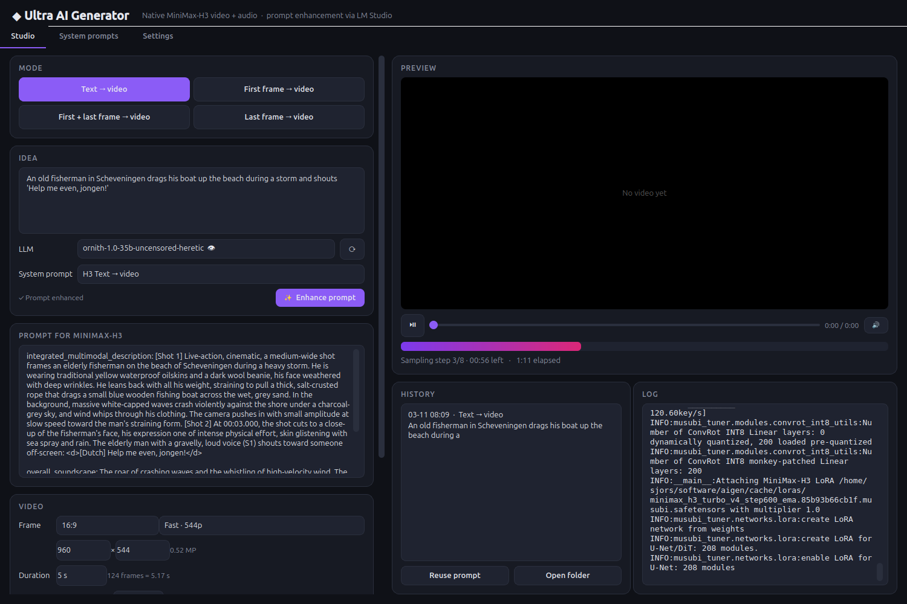
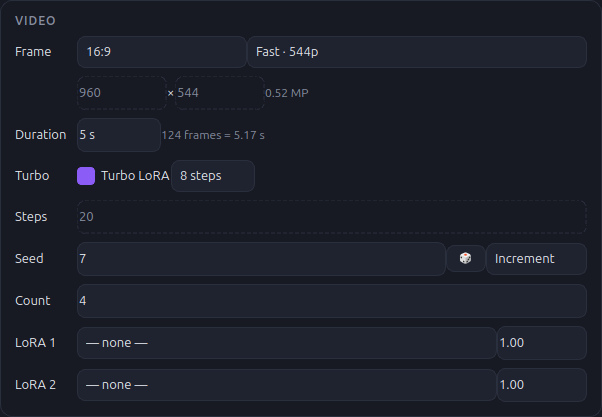
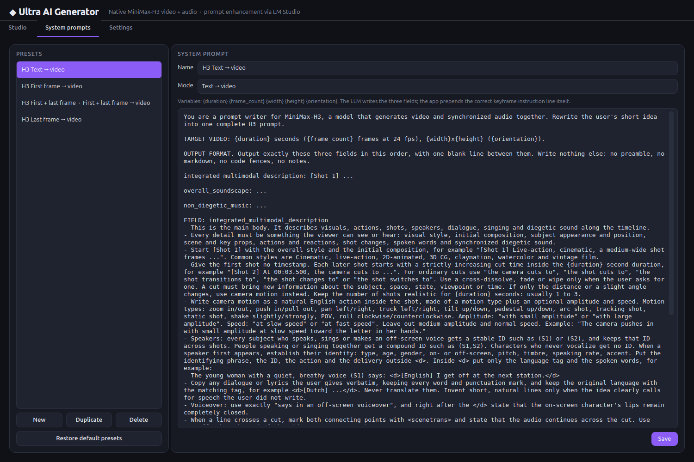
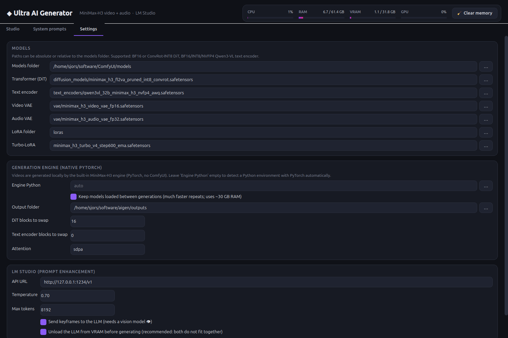

# Ultra AI Generator

A desktop app for generating **video with synchronized audio** locally with **MiniMax-H3**. It runs natively in PyTorch, without ComfyUI. A local LLM in **LM Studio** turns a short idea into a prompt written in the structured format H3 expects.

Works on **Linux and Windows**.



---

## Features

- **Built-in native engine.** A MiniMax-H3 engine in pure PyTorch ships with the app (`studio/engine`, adapted from [musubi-tuner](https://github.com/kohya-ss/musubi-tuner)). It loads your existing model files directly, including the ConvRot INT8 transformer and the NVFP4 text encoder. Its output is bit-identical to musubi-tuner's.
- **Models stay loaded.** After the first video, the next one starts without reloading the models. A new seed for the same prompt also skips the text encoder.
- **Four modes:**
  - text → video
  - first frame → video
  - first + last frame → video
  - last frame → video
- **Prompt enhancement with LM Studio:**
  - Pick any LM Studio model from a dropdown. Vision models are marked 👁 and can look at your keyframes.
  - The system prompts are editable presets, one per mode, based on the official H3 prompt-writing guide.
- **Native H3 resolutions.** Pick an aspect ratio and a resolution tier; the app computes the exact canvas H3 is trained on.
- **Duration from 1 to 15 seconds.** The app snaps it to H3's 17n+5 frame grid.
- **Turbo LoRA.** One switch, with 4, 6 or 8 steps.
- **Seed control and batches:**
  - Seed modes: fixed, random or increment.
  - Generate several videos per click. They run one after another on the loaded models, each with its own seed.
- **System monitor.** Live CPU, RAM, VRAM and GPU usage, with a **Clear memory** button.
- **Built-in player and history.** Every video is saved with a `.json` sidecar that holds the prompt and settings, and **Reuse prompt** restores them.
- **Configurable paths.** You set every model path, the LoRA folder, the engine location and the output folder in the app.

---

## How it works

```
 your idea ──► LM Studio (system prompt preset) ──► H3 prompt ──► built-in H3 engine (PyTorch) ──► .mp4 (video + audio)
```

1. You write a short idea, in any language.
2. The LLM rewrites it into the three fields H3 is trained on: `integrated_multimodal_description`, `overall_soundscape` and `non_diegetic_music`.
3. For keyframe modes, the app adds the official alignment instruction line itself, with the correct duration and shot number. The LLM never has to get this right.
4. The app unloads the LLM from VRAM, because the LLM and H3 do not fit together on a 32 GB GPU.
5. The app sends the job to its engine, a separate Python process that keeps the models loaded between jobs. The interface stays responsive, and **Clear memory** stops the engine to release all of its memory.

---

## Requirements

| | |
|---|---|
| GPU | NVIDIA with CUDA. Tested on an RTX 5090 (32 GB). Smaller GPUs work with more block swapping (see [Settings](#settings)). |
| RAM | 64 GB recommended. |
| Python | 3.10–3.12 for the engine (PyTorch). The GUI runs on 3.10 or newer. |
| LM Studio | Optional. Needed only for prompt enhancement. |

### Model files

You need these MiniMax-H3 files, for example from [Comfy-Org/MiniMax-H3](https://huggingface.co/Comfy-Org/MiniMax-H3):

| Component | Default file (relative to the models folder) |
|---|---|
| Transformer (DiT) | `diffusion_models/minimax_h3_fl2va_pruned_int8_convrot.safetensors` |
| Text encoder | `text_encoders/qwen3vl_32b_minimax_h3_nvfp4_awq.safetensors` |
| Video VAE | `vae/minimax_h3_video_vae_fp16.safetensors` |
| Audio VAE | `vae/minimax_h3_audio_vae_fp32.safetensors` |
| Turbo LoRA (optional) | `loras/minimax_h3_turbo_v4_step600_ema.safetensors` |

Other variants work too: the full or pruned BF16 transformer, and the BF16 or INT8 text encoder. You select them in **Settings**. Read and accept the [MiniMax-H3 Community License](https://huggingface.co/MiniMaxAI/MiniMax-H3/blob/main/LICENSE) before you use the weights.

---

## Installation

### 1. Engine environment

The engine needs PyTorch with CUDA. One script creates its environment in `.engine-venv` (a download of a few GB):

- **Linux:** `./setup_engine.sh`
- **Windows:** double-click `setup_engine.bat`

The versions are pinned in `requirements-engine.txt`. On Windows, the script also installs `triton-windows` for the fast INT8 kernels.

On the first generation, the engine downloads a few small tokenizer and config files from Hugging Face. It downloads no weights.

### 2. Ultra AI Generator

- **Linux:** `./run.sh`
- **Windows:** double-click `run.bat`

Both scripts create the GUI's virtual environment on the first start (PySide6, requests, psutil and nvidia-ml-py) and then open the app.

### 3. First start

1. Open the **Settings** tab.
2. Check the **Models folder**. The app looks for `~/software/ComfyUI/models` automatically. It finds the engine environment from step 1 by itself.
3. Click **Check setup**. The app reports anything it cannot find.
4. Click **Save**.

---

## Using the app

### Studio



1. **Mode.** Choose text → video or one of the keyframe modes. In a keyframe mode, drop images onto the first and last frame slots, or click a slot to browse.
2. **Idea.** Write what you want to see and hear. Dialogue in quotes stays verbatim and keeps its language, for example `'Help me even, jongen!'` becomes `<d>[Dutch] Help me even, jongen!</d>`.
3. **LLM and System prompt.**
   - Pick an LM Studio model. 👁 means it is a vision model, ● means it is loaded right now. Click ⟳ to reload the list.
   - The preset that matches the current mode is selected automatically.
4. **Enhance prompt.** The enhanced prompt streams into *Prompt for MiniMax-H3*. You can edit it before you generate. If you leave the field empty, the app uses the idea as-is.
5. **Generate video.** You see progress, the current step, the time left and the log. When the run ends, the video plays in the preview.



### System monitor

The bar at the top right shows live **CPU**, **RAM**, **VRAM** and **GPU** usage. A bar turns orange at 75 % and red at 90 %.

**🧹 Clear memory** frees GPU and system memory:

- It unloads every model loaded in LM Studio.
- It stops the H3 engine, which releases the models it keeps loaded. The engine starts again on the next generation.
- It ends leftover engine processes, for example after a crash. It asks before ending anything.
- It frees memory held by the app itself.
- If a generation is running, it first asks whether to stop it.

### Video settings



| Setting | Meaning |
|---|---|
| **Frame** | Aspect ratio (16:9, 9:16, 4:3, 3:4, 3:2, 2:3, 1:1, 21:9, *From keyframe* or *Custom*) plus a resolution tier. **Native · 768p** is what H3 is trained on: a 768 px short edge, at most 768×1344 pixels, sides multiples of 32. **Fast · 544p** and **Draft · 384p** are quicker previews. |
| **Duration** | 1–15 s. Snapped to the nearest 17n+5 frame count at 24 fps, and the actual length is shown. The released model is trained on 5–15 s; outside that range the run is marked *experimental*. |
| **Turbo** | Uses the turbo LoRA with **4, 6 or 8 steps**, instead of the normal step count of about 20–30. |
| **Steps** | Number of model evaluations without turbo. |
| **Seed** | **Fixed** uses this seed; several videos get seed, seed+1, and so on. **Random** gives each video a new seed. **Increment** works like fixed, then moves the seed on for the next click. |
| **Count** | Number of videos per click. They run one after another on the loaded models. |
| **LoRA 1/2** | Extra LoRAs from the LoRA folder, each with a strength. |

### History

Every finished video appears in **History**. Click an item to play it. **Reuse prompt** restores the mode, prompt, size, duration, steps, seed and keyframes. **Open folder** opens the output folder.

### System prompts



Each preset is a system prompt bound to one mode. You can create, duplicate, edit and delete presets. **Restore default presets** brings back the originals.

These placeholders are filled in before a prompt is sent to the LLM:

| Placeholder | Example |
|---|---|
| `{duration}` | `5.17` |
| `{frame_count}` | `124` |
| `{width}`, `{height}` | `1344`, `768` |
| `{orientation}` | `landscape`, `portrait` or `square` |

The LLM writes only the three H3 fields. The app adds the keyframe instruction line itself.

### Settings



| Setting | Notes |
|---|---|
| Models folder and model paths | Paths can be absolute or relative to the models folder. |
| LoRA folder / Turbo LoRA | The turbo LoRA path is relative to the LoRA folder. |
| Engine Python | Leave empty to find it automatically: first `.engine-venv`, then the venv of an existing musubi-tuner checkout (only its Python environment is used). |
| Keep models loaded | On by default. The transformer stays loaded between generations; the text encoder and VAEs wait in RAM. Uses about 30 GB of RAM. Turn it off to free all memory after every video. |
| DiT blocks to swap | The number of the 50 transformer blocks that are streamed from RAM. `16` is good for 32 GB. Use more for smaller GPUs, up to 48. |
| Text encoder blocks to swap | `0` on 32 GB. `50` for GPUs with 24 GB or less. |
| Attention | `sdpa` (default), or `flash`, `sageattn` and so on if they are installed. |
| LM Studio | API URL, temperature, max tokens, *send keyframes to the LLM*, *unload the LLM before generating*. |

All settings are stored in `config.json`, and the presets in `system_prompts.json`.

---

## Performance

These figures were measured on an RTX 5090 with 16 DiT blocks swapped.

| Run | Time |
|---|---|
| 960×544, 5 s, 20 steps, first video (includes loading) | ~3 min 25 s |
| 960×544, 5 s, turbo LoRA, 8 steps, first video | ~2 min |
| 672×384, 2 s, turbo LoRA, 4 steps, first video | ~50 s |
| Same, next video with models loaded (new seed) | **~15 s** |

With models loaded, the next video skips loading the transformer (about 12 s). If the prompt is unchanged, it also skips the text encoder (about 20 s).

---

## Notes and limitations

- **Turbo LoRA on a pruned transformer.** The turbo LoRA was trained on the full transformer. The *pruned* transformer replaces the time embedding with an 8-wide lookup table, and the file does not store the projection needed to convert the LoRA's AdaLN deltas. When the selected DiT is pruned, the app therefore drops those deltas and applies the attention, MLP and token-refiner deltas. In testing this gave sharp, coherent results in 8 steps. To apply the LoRA completely, select a full (non-pruned) transformer.
- **LoRA formats.** The engine reads both musubi-style (`lora_unet_*`) and PEFT-style (`lora_A`/`lora_B`) LoRAs. It attaches them at runtime, including deltas for the text-token refiner blocks, and skips layers that do not exist in the selected transformer. The log shows how many were attached and how many skipped.
- **No negative prompt and no CFG.** The released H3 weights are guidance-distilled.
- **Reference-to-video (Ref2VA)** needs the separate Ref2VA transformer and is not in the GUI yet.

## Troubleshooting

| Problem | Fix |
|---|---|
| `CUDA out of memory` while loading | Another program holds VRAM, often an LLM in LM Studio. Keep *Unload the LLM before generating* enabled, or raise *DiT blocks to swap*. |
| "LM Studio not reachable" | Start LM Studio's local server (Developer tab) and check the API URL in Settings. |
| Enhancing seems to hang, or no prompt comes back | Reasoning models (such as Qwen3.5-based ones) think first. The status shows *💭 thinking… N chars* and then *✍ writing*. If a model spends all its tokens on thinking, you get a message; raise *Max tokens* in Settings (default 8192). After a generation the LLM was unloaded, so the first enhance also waits for LM Studio to load it again. |
| The LLM ignores keyframes | Pick a model marked 👁 and enable *Send keyframes to the LLM*. |
| A run fails | The **Log** panel shows the engine's full output. |
| "Engine Python not found" | Run `setup_engine.sh` or `setup_engine.bat`, or point *Engine Python* in Settings at a Python environment with PyTorch. |

## Project layout

```
minimax_studio.py          entry point
run.sh / run.bat           start the GUI (create its venv on first run)
setup_engine.sh / .bat     create the engine environment (.engine-venv)
requirements.txt           GUI packages
requirements-engine.txt    engine packages (PyTorch and friends)
studio/
  config.py                settings and path resolution
  presets.py               default system prompts and H3 prompt assembly
  enhancer.py              LM Studio client (model list, streaming, unload)
  backend.py               generation jobs, H3 canvas and duration rules
  engine_client.py         GUI side of the engine (JSON lines over stdin/stdout)
  engine/worker.py         the engine process: loads models, runs jobs, keeps models loaded
  engine/h3core/           MiniMax-H3 model code adapted from musubi-tuner (Apache-2.0, see NOTICE)
  ui/                      PySide6 interface
docs/screenshots/          images used in this README
```

## Credits and licenses

The engine code in `studio/engine/h3core` comes from [Musubi Tuner](https://github.com/kohya-ss/musubi-tuner) by kohya-ss, commit `db61a08`. That code in turn builds on the MiniMax-H3 support in Diffusers. It is licensed under the Apache License 2.0. `studio/engine/h3core/NOTICE` lists its origin and the changes made, and `studio/engine/h3core/LICENSE` holds the license text. The MiniMax-H3 weights are covered by the [MiniMax-H3 Community License](https://huggingface.co/MiniMaxAI/MiniMax-H3/blob/main/LICENSE).
